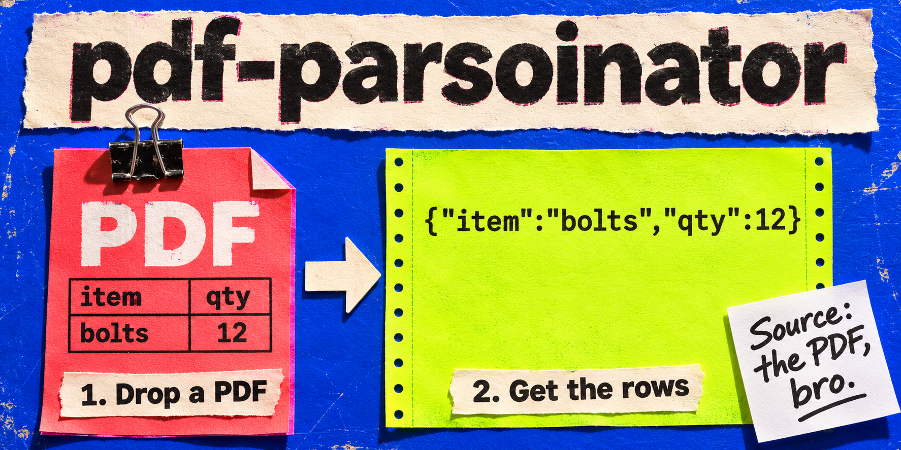
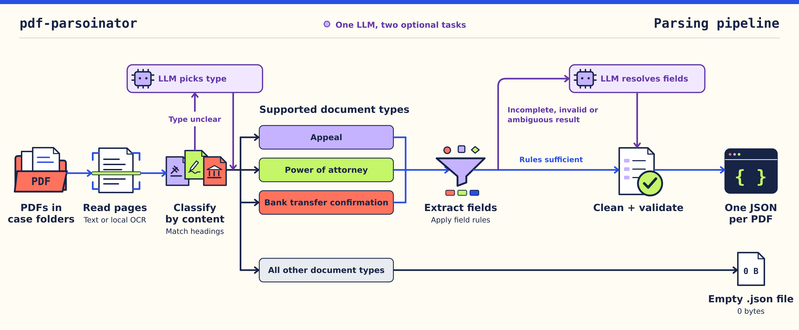
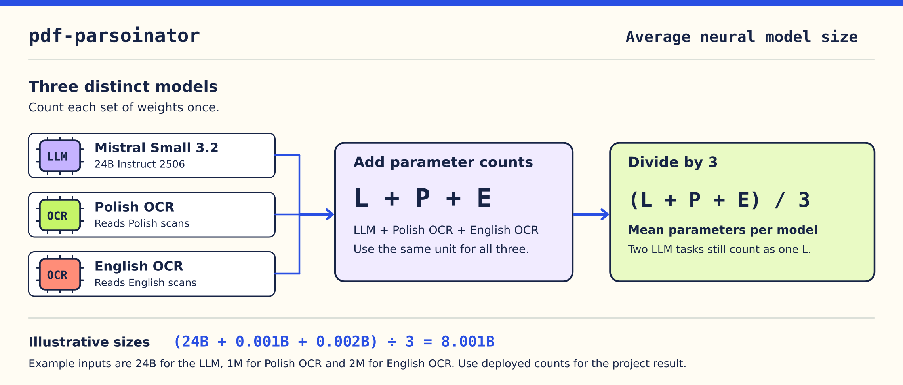

# 

## Project structure

```text
Akta-odwolawcze/
├── input/                       # PDF case folders supplied at runtime
│   └── .gitkeep
├── output/                      # Mirrored JSON case folders
│   └── .gitkeep
├── config/                      # Document types and appeal cause dictionary
│   ├── causes.json
│   ├── odwolanie.json
│   ├── pelnomocnictwo.json
│   └── przelew.json
├── scripts/                     # Reproducible public checks
│   └── check_public.py
├── docs/                        # Verification, experiment history and jury guide
│   ├── assets/
│   │   ├── parsoinator.png
│   │   ├── pdf-parsoinator-visual-pipeline.png
│   │   └── three-model-average.png
│   ├── experiments.md
│   ├── jury-pl.md
│   └── verification.md
├── benchmarks/                  # Measured results and historical experiment patches
│   ├── first-claim.patch
│   ├── ocr-company-suffix.patch
│   ├── public-rerun.json
│   ├── readiness.json
│   ├── scaleway-scans-v2-live.json
│   └── scaleway-scans-v3-replay.json
├── tessdata/                    # Bundled OCR languages and their license
│   ├── eng.traineddata
│   ├── LICENSE
│   └── pol.traineddata
├── tests/                       # Regression tests
│   ├── test_contract.py
│   ├── test_fields.py
│   ├── test_names.py
│   ├── test_readiness.py
│   └── test_scan_fields.py
├── .dockerignore
├── .env.example                 # Hosted settings template with a blank key
├── .gitignore
├── check_api.py                 # One-request API check
├── compose.yaml
├── Dockerfile
├── evaluate.py                  # Public split evaluator and scan replay
├── extractor.py                 # PDF reading, OCR, classification and routing
├── fields.py                    # Field rules for native text
├── index.html                   # Browser review interface
├── LICENSE
├── names.py                     # Polish name normalization
├── README.md
├── requirements-dev.txt
├── requirements.txt
├── run.py                       # Batch and local web entry point
├── scan_fields.py               # Field corrections for scans
└── start-local-model.sh         # Optional local model for development
```

## Extraction pipeline



**PDF parsing pipeline.** The parser reads each PDF in a case folder, using local OCR when needed, and classifies it by content. Appeals, powers of attorney, and bank transfer confirmations proceed to field extraction. The same LLM can identify the document type when headings are unclear and resolve fields when extraction rules are insufficient. The parser cleans and validates each supported record, then writes one JSON file per PDF. UZP requires a matching `.json` file containing `{}` for all other document types.

### Models used in the pipeline



Mistral Small 3.2 24B handles classification and extraction. Local Tesseract uses Polish (286,609 weights) and English (385,807 weights). The illustration uses example OCR sizes to obtain 8.001B. UZP's archived LLM table gives the single 24B model 12/20. The final model-size rule is unconfirmed.

## Run your first case

PDF Parsoinator reads a folder of Polish procurement case files and produces one result per PDF. It recognizes appeals to the National Appeals Chamber (KIO), powers of attorney and bank transfer confirmations. It preserves filenames and case folders. Scanned pages can be read locally using the bundled Polish and English OCR data.

### 1. Install

Use Git and Python 3.13. Run the following from the folder where you keep projects. If you already have this checkout, start with the environment creation line **inside the repository**.

**Linux or WSL**

```bash
git clone https://github.com/kubameixner2-ui/Akta-odwolawcze.git
cd Akta-odwolawcze
python3.13 -m venv .venv
.venv/bin/python -m pip install -r requirements.txt
```

If Ubuntu has no `python3.13` command and you have `uv`, use `uv venv --python 3.13 --seed .venv` for the environment creation line. All examples call the environment’s interpreter directly and also work in a new terminal opened at the repository root. [Installing uv](https://docs.astral.sh/uv/getting-started/installation/)

**Windows PowerShell**

```powershell
git clone https://github.com/kubameixner2-ui/Akta-odwolawcze.git
cd Akta-odwolawcze
py -3.13 -m venv .venv
.\.venv\Scripts\python.exe -m pip install -r requirements.txt
```

### 2. Run the example and open the results

The demo fetches eight public PDFs, invokes the same batch command used for judging, then checks the outputs against the organizer’s references. It runs on the CPU without an API key. Run the command for your platform.

| Linux or WSL | Windows PowerShell |
| --- | --- |
| `.venv/bin/python scripts/check_public.py demo` | `.\.venv\Scripts\python.exe scripts/check_public.py demo` |

The terminal prints a new folder under `results/demo-rules-*/`. Open its `output/` folder to inspect the JSONs and `report.json` to check the counts. Expect **8 outputs, 7 exact JSON records, 1 correct zero-byte file and `passed: true`**. Each invocation uses a fresh folder. If you already have the organizer’s pinned dataset, append `--data /path/to/dane` to skip the download. [Public fixtures][data]

| Case folder | PDF inside `input/<case>/` | Result inside `output/<case>/` | Expected content |
| --- | --- | --- | --- |
| `case1` | `odwolanie_nr_1.pdf` | `odwolanie_nr_1.json` | Appeal for procedure `ZS.791.2026` |
| `case1` | `pelnomocnictwo_nr_1.pdf` | `pelnomocnictwo_nr_1.json` | First power of attorney |
| `case1` | `pelnomocnictwo_nr_2.pdf` | `pelnomocnictwo_nr_2.json` | Second, distinct power of attorney |
| `case1` | `przelew_nr_1.pdf` | `przelew_nr_1.json` | Transfer `CEN2604016344389`, amount `200.0` |
| `case2` | `odwolanie_nr_2.pdf` | `odwolanie_nr_2.json` | Appeal |
| `case2` | `pelnomocnictwo_nr_3.pdf` | `pelnomocnictwo_nr_3.json` | Power of attorney |
| `case2` | `przelew_nr_2.pdf` | `przelew_nr_2.json` | Bank transfer |
| `case3` | `attachment.pdf` | `attachment.json` | Excluded notice, exactly 0 bytes |

These are generated demonstration files. The repository ships empty `input/` and `output/` folders for the judge’s own cases. The demo assembles its layout from public cases 01–04, including the extra power of attorney from case 03. [Organizer’s filename example][layout]

### 3. Run a judging batch

1. Place the team’s privately supplied `.env` beside `run.py`. For a new team setup, copy `.env.example` to `.env` and fill in the value of `KIO_LLM_API_KEY` locally. The template includes the hosted URL and model ID. The program loads the file itself. Supply the key to the judges privately.
2. Place PDFs in `input/`, using the case folders you want to preserve. Use an empty output folder for each new assessment. For another location, pass `--input PATH --output PATH`.
3. Run the API check, then the batch. The check prints `ok` after one schema-constrained model request.

| Action | Linux or WSL | Windows PowerShell |
| --- | --- | --- |
| Verify the configured API | `.venv/bin/python check_api.py` | `.\.venv\Scripts\python.exe check_api.py` |
| Process `input/` into `output/` | `.venv/bin/python run.py` | `.\.venv\Scripts\python.exe run.py` |
| Time the public 150-PDF fixture with the judging configuration | `.venv/bin/python scripts/check_public.py timing --mode hybrid` | `.\.venv\Scripts\python.exe scripts/check_public.py timing --mode hybrid` |

The default mode is `hybrid`. It reads the PDF on the CPU and uses rules for recognized fields. When it needs model assistance it sends extracted text to the configured API. `--mode rules` runs entirely on the CPU without an API key. `--mode llm` requests model extraction for each document classified as supported. Use `--trace` for the extraction route, OCR page numbers and page references for literal matches on standard error. [Extraction and routing](extractor.py)

Output JSON uses the official Polish field names. A missing value is `null` where the schema permits it. An excluded PDF gets a zero-byte `.json` at the corresponding path. Batch errors name the affected file on standard error and return a nonzero exit code. UZP requires **150 PDFs within 45 minutes**, CPU-capable execution, and an API with EU/EEA processing for hosted inference. [Current judging specification][spec] · [45-minute limit][time] · [Scaleway deployment region][provider] · [Model card][model]

### 4. Review a PDF in the browser

| Linux or WSL | Windows PowerShell |
| --- | --- |
| `.venv/bin/python run.py --ui --mode rules` | `.\.venv\Scripts\python.exe run.py --ui --mode rules` |

Open the address printed by the server. Choose a PDF, run the analysis, then inspect the first-page preview beside its JSON and use the download link. The browser saves the result to its download location. Omit `--mode rules` to use the configured hybrid extractor. If the default port is busy the server prints a free port. Stop it with **Ctrl+C**.

## Measured results

The public training directory has **226 PDF paths** across three groups. The native and scan rows measure field extraction. Exclusions are scored by checking that the output file exists and contains zero bytes. The live and replay rows use the **same 30 scans**. [Public dataset][data] · [Measurement record](benchmarks/readiness.json)

| Public inputs and method | PDFs | True positives | False positives | False negatives | Precision | Recall | Field micro-F1 | Exact documents |
| --- | ---: | ---: | ---: | ---: | ---: | ---: | ---: | ---: |
| Native text · CPU rules | 180 | 2,032 | 0 | 0 | 100.00% | 100.00% | **100.00%** | 180/180 |
| Scans · CPU rules | 30 | 132 | 24 | 177 | 84.62% | 42.72% | **56.77%** | 0/30 |
| Scans · hosted hybrid, live v2 | 30 | 299 | 14 | 10 | 95.53% | 96.76% | **96.14%** | 18/30 |
| Scans · offline replay of v2, updated corrections | 30 | 301 | 9 | 8 | 97.10% | 97.41% | **97.25%** | 21/30 |
| Excluded documents · CPU rules | 16 | — | — | — | — | — | — | 16/16 empty |

On the 30 scans, bank transfers had the lowest live F1 at **91.74%**. After replay, three transfer titles still differed from the references. Those three values account for **6 of the 17** remaining false positives and false negatives. Replaying corrects saved predictions using the PDF and OCR. A fresh API run can produce different values. The organizer scores a separate, undisclosed test set. [Per-class scores, field errors and method](docs/verification.md#where-the-scan-errors-are) · [Official testing procedure][spec]

| Timed batch · CPU rules | Measured | Interpretation |
| --- | ---: | --- |
| 104 native PDFs + 30 scans + 16 exclusions | 150 paths | 145 distinct PDF contents |
| Wall time | **325.17 s** | 5 min 25.17 s for the batch CLI. The limit is 2,700 s. |
| Mean processing time | **2.17 s/PDF** | The limit allows 18 s/PDF on average. |
| Output files at expected paths | **150/150** | All 124 nonempty files contained schema-valid JSON. |
| Correct disposition | **140/150** | 10 supported scans were incorrectly empty. All 16 exclusions were correctly empty. |
| Exact documents, including exclusions | **120/150** | 104 native, 0 scanned and 16 excluded documents matched. |

Run `.venv/bin/python scripts/check_public.py timing --mode hybrid` from the project root to fetch the pinned dataset and time the hosted batch. The full 150-file **hosted hybrid** timing still needs a run with the team API on the judging setup. The organizer has placed the hardware specification under review. [Reproduce the timed run](docs/verification.md#run-the-150-pdf-check) · [Organizer’s timing rule][time]

## Operate and extend

| Task | Where to go |
| --- | --- |
| Reproduce all public splits, replay saved predictions or diagnose startup | [Verification runbook](docs/verification.md) |
| Add a class or field | Add a file in `config/` with `label`, `headings`, `instructions` and a JSON `schema`, or edit an existing one. Restart and use hybrid or LLM mode. [Transfer example](config/przelew.json) · [Extension tests](tests/test_contract.py) |
| Run the default batch in Docker | Put the private `.env` and `input/` in place, then run `docker compose run --rm --build extractor`. [Compose definition](compose.yaml) |
| Review earlier model comparisons or read the jury guide in Polish | [Earlier experiments](docs/experiments.md) · [Polish jury guide](docs/jury-pl.md) |
| Check redistribution terms | [Application license](LICENSE) · [Bundled OCR data license](tessdata/LICENSE) |

[data]: https://github.com/Urzad-Zamowien-Publicznych/hacknation-2026/tree/84cc976f0a9af5cee14f131c795f929134ca0fda/dane
[layout]: https://github.com/Urzad-Zamowien-Publicznych/hacknation-2026/blob/0b360a9da4b482a6a280696df6714404e0953505/README.md#L66-L101
[spec]: https://github.com/Urzad-Zamowien-Publicznych/hacknation-2026/blob/0b360a9da4b482a6a280696df6714404e0953505/README.md#L119-L184
[time]: https://github.com/Urzad-Zamowien-Publicznych/hacknation-2026/blob/0b360a9da4b482a6a280696df6714404e0953505/README.md#L186-L192
[provider]: https://www.scaleway.com/en/docs/generative-apis/faq/
[model]: https://huggingface.co/mistralai/Mistral-Small-3.2-24B-Instruct-2506
