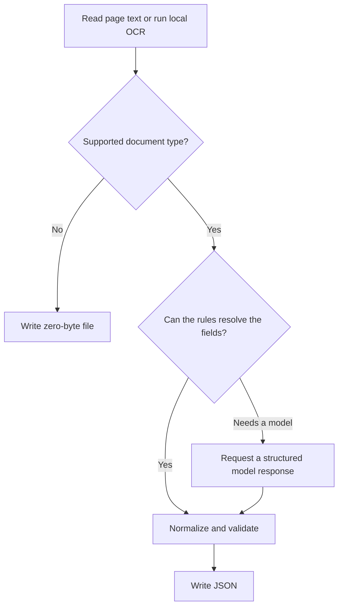

# KIO Appeals to JSON

Convert case files from Poland’s National Appeals Chamber (KIO) into structured data. Give the CLI a folder of PDFs, or open one PDF in the browser to inspect its extracted fields beside the source. The extractor identifies each document by its contents and preserves the case folder structure.

[Run a sample case](#run-a-sample-case) · [Judging runbook](#judging-runbook) · [Benchmark results](#benchmark-results) · [Repository map](#repository-map)

## Run a sample case

Process all three documents in the organizer’s first public case. The example needs Git and Python 3.13 and runs on the CPU without an API key. The files below appear in `results/demo/`. Their JSON keys follow the organizer’s Polish schemas. [Sample PDFs and reference JSONs][case]

| Document | Output file | What you can verify in case 01 |
| --- | --- | --- |
| Procurement appeal | `odwolanie.json` | The challenged action is dated `2026-03-20` in procedure `ZS.791.2026`. |
| Power of attorney | `pelnomocnictwo.json` | One grantor appoints two attorneys. |
| Bank transfer confirmation | `przelew.json` | Transaction `CEN2604016344389` has an amount of `200.0`. |

**Linux or WSL.** Run this block from a directory where you want the project cloned. If WSL uses `uv`, replace the environment creation line with `uv venv --python 3.13 --seed .venv`.

```bash
git clone https://github.com/kubameixner2-ui/Akta-odwolawcze.git
cd Akta-odwolawcze
python3.13 -m venv .venv
source .venv/bin/activate
python -m pip install -r requirements.txt

git clone --filter=blob:none --no-checkout https://github.com/Urzad-Zamowien-Publicznych/hacknation-2026.git results/uzp
git -C results/uzp sparse-checkout set dane/przyklad_01
git -C results/uzp checkout --detach 84cc976f0a9af5cee14f131c795f929134ca0fda
python run.py --mode rules --input results/uzp/dane/przyklad_01 --output results/demo
```

<details>
<summary><strong>Windows PowerShell</strong> · Run the same example</summary>

```powershell
git clone https://github.com/kubameixner2-ui/Akta-odwolawcze.git
cd Akta-odwolawcze
py -3.13 -m venv .venv
.\.venv\Scripts\python.exe -m pip install -r requirements.txt

git clone --filter=blob:none --no-checkout https://github.com/Urzad-Zamowien-Publicznych/hacknation-2026.git results/uzp
git -C results/uzp sparse-checkout set dane/przyklad_01
git -C results/uzp checkout --detach 84cc976f0a9af5cee14f131c795f929134ca0fda
.\.venv\Scripts\python.exe run.py --mode rules --input results/uzp/dane/przyklad_01 --output results/demo
```

Use `.\.venv\Scripts\python.exe` wherever the remaining examples use `python`.

</details>

<details>
<summary><strong>Inspect the JSON and verify all three records</strong></summary>

This excerpt from `results/demo/przelew.json` shows why account numbers are strings. The payer’s account starts with a zero. The amount is a JSON number.

```json
{
  "przelew_bankowy": {
    "z_rachunku": "05470680287581539721455024",
    "kwota": 200.0,
    "data_operacji": "2026-03-21",
    "numer_transakcji": "CEN2604016344389"
  }
}
```

With the sample-only checkout above, run the evaluator. It renames the PDFs before extraction and compares the resulting records with the official references.

```sh
python evaluate.py results/uzp/dane --split dev --mode rules --output results/demo-check
```

Under `results.ALL`, expect `documents: 3`, `exact: 3` and `f1: 1.0`.

</details>

## Judging runbook

The target is an Intel i7 office laptop with 16 GB of RAM and no GPU. [Organizer’s specification][spec]

1. Install the application as above. Place the team’s private `.env` beside `run.py`. It is loaded automatically.
2. Put the judging PDFs in `input/`, grouped into case folders. Start with a fresh `output/` directory.
3. From the repository root, check the hosted API and run the batch.

```sh
python check_api.py
python run.py
```

The check prints `ok` after one live model request. The batch uses `hybrid` mode. PDF reading and OCR run locally on the CPU. When classification or field extraction needs the model, the client sends selected document text to Scaleway’s Paris service. [Provider region][scaleway] · [Model card][mistral]

<details>
<summary><strong>API settings used for the hosted run</strong></summary>

```dotenv
KIO_LLM_BASE_URL=https://api.scaleway.ai/v1
KIO_LLM_MODEL=mistral/mistral-small-3.2-24b-instruct-2506:fp8
KIO_LLM_API_KEY=YOUR_PRIVATE_TEAM_KEY
```

Replace the placeholder in your private `.env` with the team key. Existing environment variables take precedence.

</details>

**Output contract.** `input/case-07/attachment.pdf` produces `output/case-07/attachment.json`. A recognized PDF gets a schema-validated UTF-8 record. Missing nullable fields use `null`. An out-of-scope PDF gets a **zero-byte** `.json` file at the expected path. A file-processing error is reported on standard error and yields a nonzero batch exit code.

| To do this | Run from the repository root |
| --- | --- |
| Review a PDF beside its JSON and download the result | `python run.py --ui`, then open `http://127.0.0.1:8765`. If the port is busy, add `--port 8766` and open that port. |
| Record the extraction route, OCR pages and literal field matches | `python run.py --input input --output output --trace 2> output/trace.log` |
| Process a folder entirely on the CPU with field rules | `python run.py --mode rules` |
| Use the model for full extraction of each recognized PDF | `python run.py --mode llm` |
| Run the judging batch in Docker | `docker compose run --rm --build extractor` |

## Benchmark results

The live hosted run classified **30/30 scans** correctly in **271.75 seconds**. Eighteen records matched their references in full. These public scans informed development. The competition uses a separate hidden set. [Live score report][live] · [Public evaluation data][data]

| Public inputs | Extraction method | Exact outputs | Field micro-F1 |
| --- | --- | ---: | ---: |
| 30 scanned PDFs | Fresh hosted hybrid run | 18/30 | **96.14%** |
| The same 30 scans | Offline replay of saved predictions with updated OCR corrections | 21/30 | **97.25%** |
| 180 native-text PDFs | Rules only | 180/180 | **100.00%** |
| 16 out-of-scope PDFs | Rules only | 16/16 zero-byte files | — |

Field micro-F1 pools matching non-null values across documents using their JSON paths, types and list positions. A single wrong digit can lose a whole-document match. Replay rereads the PDFs and applies corrections to saved per-document JSON files with zero new model calls. The public live report includes the counts for each class. [Evaluator](evaluate.py)

<details>
<summary><strong>Reproduce the public evaluations</strong></summary>

Expand the pinned sample checkout to the full dataset. The two native-text splits cover 48 and 12 cases, respectively, with three supported documents per case. Each command prints a report and writes predictions to its own directory.

```sh
git -C results/uzp sparse-checkout set dane
python evaluate.py results/uzp/dane --split dev --mode rules --output results/native-dev
python evaluate.py results/uzp/dane --split holdout --mode rules --output results/native-holdout
python evaluate.py results/uzp/dane --split negatives --mode rules --output results/exclusions
```

For scans, run hosted inference first to create 30 prediction files. The second command replays your saved predictions. Reproducing the historical 97.25% exactly requires the predictions from that historical run.

```sh
python evaluate.py results/uzp/dane --split scans --mode hybrid --output results/scans-live
python evaluate.py results/uzp/dane --split scans --replay-from results/scans-live --output results/scans-replay
```

</details>

## Repository map

| Responsibility | Where to look |
| --- | --- |
| Batch CLI, local HTTP server and browser review | [run.py](run.py) · [index.html](index.html) |
| PDF reading, OCR, classification and model routing | [extractor.py](extractor.py) · [OCR language data](tessdata/) · [API check](check_api.py) |
| Field rules, name normalization and scan corrections | [fields.py](fields.py) · [names.py](names.py) · [scan_fields.py](scan_fields.py) |
| Document schemas, headings and extraction instructions | [Appeals](config/odwolanie.json) · [Powers of attorney](config/pelnomocnictwo.json) · [Transfers](config/przelew.json) · [Appeal reason codes](config/causes.json) |
| Evaluation and regression tests | [evaluate.py](evaluate.py) · [tests/](tests/) · [Benchmark reports](benchmarks/) |
| Container and optional local inference setup | [Compose](compose.yaml) · [Dockerfile](Dockerfile) · [Local model launcher](start-local-model.sh) |

<details>
<summary><strong>How hybrid mode processes a PDF</strong></summary>



The classifier checks the document’s own headings and content. Ambiguous cases can go to the model. For an appeal, hybrid mode can ask a focused question about the first challenged action. A document with unresolved fields can go through full schema-constrained extraction.

</details>

<details>
<summary><strong>Add a document type or field</strong></summary>

For example, save this definition as `config/invoice.json` and restart in `hybrid` or `llm` mode. A PDF headed “Invoice” can then return an `invoice_number` field.

```json
{
  "label": "Invoice",
  "headings": ["Invoice"],
  "instructions": "Copy the invoice number exactly. Use null when it is missing.",
  "schema": {
    "type": "object",
    "properties": {"invoice_number": {"type": ["string", "null"]}},
    "required": ["invoice_number"],
    "additionalProperties": false
  }
}
```

To add a field to an existing type, update its schema and instructions. The contract tests exercise both changes. [Transfer configuration](config/przelew.json) · [Extension tests](tests/test_contract.py)

</details>

### Development checks

```sh
python -m pip install -r requirements-dev.txt
python -m mypy --check-untyped-defs run.py check_api.py evaluate.py tests
python -m unittest discover -s tests -v
```

[Application license (AGPL-3.0)](LICENSE) · [OCR data license (Apache-2.0)](tessdata/LICENSE) · [Earlier experiments](BENCHMARK.md) · [Polish jury guide](DLA_JURY.md)

[case]: https://github.com/Urzad-Zamowien-Publicznych/hacknation-2026/tree/84cc976f0a9af5cee14f131c795f929134ca0fda/dane/przyklad_01
[data]: https://github.com/Urzad-Zamowien-Publicznych/hacknation-2026/tree/84cc976f0a9af5cee14f131c795f929134ca0fda/dane
[spec]: https://github.com/Urzad-Zamowien-Publicznych/hacknation-2026/blob/84cc976f0a9af5cee14f131c795f929134ca0fda/README.md
[live]: benchmarks/scaleway-scans-v2-live.json
[scaleway]: https://www.scaleway.com/en/docs/generative-apis/faq/
[mistral]: https://huggingface.co/mistralai/Mistral-Small-3.2-24B-Instruct-2506
